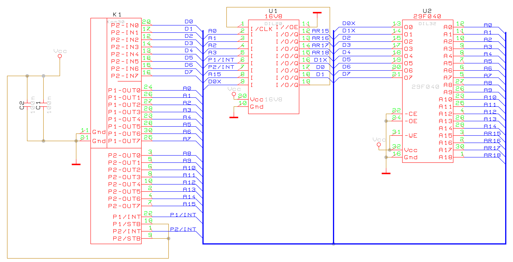

# SAPI ROM Modul

Projekt ROM modulu pro počítač SAPI. Složka `Wincupl1` obsahuje zdroj logiky GAL, testovací vektory a výsledný soubor JEDEC.

## Schéma

Schéma má bílé pozadí pro lepší čitelnost na obrazovce i při tisku.

## Obsah

- `rommodul.png` – schéma zapojení.
- `Wincupl1/gal1.pld` – zdrojový návrh CUPL pro GAL.
- `Wincupl1/gal1.sim` – vstupní vektory pro simulaci.
- `Wincupl1/gal1.jed` – výsledný JEDEC soubor pro naprogramování GAL.

## Poznámky

Zdrojový návrh a soubor JEDEC jsou poskytnuty tak, jak jsou. Před použitím v zařízení ověřte zapojení, cílový typ GAL a výsledek programování.
